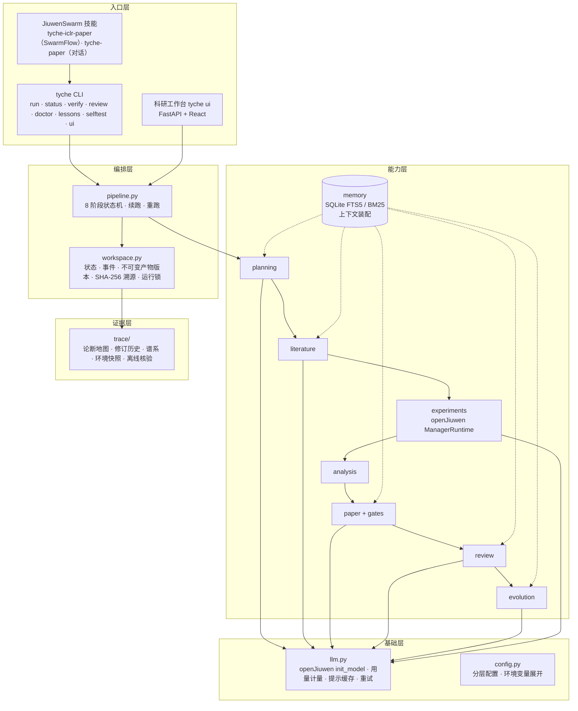

# Tyche 架构设计文档

Tyche 是基于 openJiuwen JiuwenSwarm（Apache-2.0）源码构建的 Agent 科研短论文生成智能体。给定一个 Agent 方向的研究题目，它依次完成研究规划、文献调研、实验、统计分析、论文写作、模拟评审与修订、经验演进和打包，输出一篇可编译的 ICLR 2027 模板短论文，并附带完整的证据链。

## 1. 设计原则：模型提议，代码核验

论文里最容易出错、也最影响可信度的内容是参考文献和结果数字。Tyche 按职责把系统一分为二：

| 由模型完成 | 由确定性代码完成 |
|---|---|
| 研究计划、检索式、文献相关度判断、证据卡观点、主题归纳 | 学术 API 检索、元数据核验（arXiv / Crossref 回查）、证据卡引文与摘要逐字比对 |
| openJiuwen 实验智能体：实验设计、编写实验代码、根据失败反思修订 | 真实执行实验代码，收集各变体的指标文件 |
| — | 统计：均值、bootstrap 置信区间、配对置换检验、允许数字登记表、表格与图 |
| 分节写作、定向修订、篇幅压缩、LaTeX 修复 | 清洗、编译、页数判定、门禁（编译 / 数字 / 引用 / 结构 / 占位符 / 内部术语）、接受或回滚修订 |
| 评审团打分与发现、忠实度审计 | 发现中的引文核对、台账状态机、综合分与接受检验 |
| 写作经验提炼 | 经验晋升与淘汰的门控 |
| — | AI use statement、复现声明、打包、离线核验 |

模型不能提供任何书目信息或结果数字。证据缺失、失败或无法核验时，阶段以 `StageError` 停止并说明原因；系统中没有用编造内容补位的回退路径。门禁有阻断项时拒绝打包，只有显式传入 `--allow-gate-failures` 才会打包，这时论文文件名与 AI use statement 都会标注 UNVERIFIED。

## 2. 分层结构

| 层 | 模块 | 职责 |
|---|---|---|
| 入口 | `tyche/cli.py` | 命令行入口；`run` 按阶段执行并可 `--resume` / `--from-stage` / `--stop-after`；`verify` 离线核验打包目录 |
| 入口 | `tyche/web/` | 本机科研工作台：发起、审批、跟踪运行，12 个视图展示论文、计划、文献、实验、结果、评审、论断地图、修订、谱系等 |
| 入口 | `skills/tyche-iclr-paper`、`skills/tyche-paper` | JiuwenSwarm 蜂群技能与 Agent 模式入口；阶段智能体只执行对应命令并汇报状态，证据规则全部在 `tyche` 内执行 |
| 编排 | `tyche/pipeline.py` | 阶段顺序、输入输出、失败处理、运行报告 |
| 编排 | `tyche/workspace.py` | `state.json`、`events.jsonl`、`artifacts/<name>/v<N>`、`provenance.jsonl`、按运行的排他锁 |
| 能力 | `tyche/planning.py` | 研究计划（研究问题、可证伪假设、方法、基线、指标、贡献、范围限制） |
| 能力 | `tyche/literature/` | 三源检索、限速与缓存、去重、BM25 预排序、筛选、一跳引文扩展、核验、证据卡、综述 |
| 能力 | `tyche/experiments/bridge.py` | 驱动 openJiuwen `auto_research` 的实验闭环；也支持导入团队自有结果 |
| 能力 | `tyche/analysis/` | 统计量、配对比较、天花板与地板效应、允许数字登记表、表格与图 |
| 能力 | `tyche/paper/` | 章节契约、上下文装配、写作、确定性清洗、ICLR 模板组装与编译、声明生成 |
| 能力 | `tyche/gates/checks.py` | 编译、数字、引用、结构、占位符、内部术语门禁 |
| 能力 | `tyche/review/` | 三位视角评审加忠实度审计、发现台账、修订接受检验 |
| 能力 | `tyche/evolution/playbook.py` | 跨运行写作经验的提炼、晋升、淘汰与导出 |
| 能力 | `tyche/memory/` | 带来源、作用域与更正链的科研记忆；按预算装配每次调用的上下文 |
| 基础 | `tyche/llm.py`、`tyche/cache.py` | 通过 openJiuwen 的 `init_model` 接入 OpenAI 兼容服务；逐次记录 token、缓存命中与时延；提示缓存适配；瞬时网络错误退避重试 |
| 证据 | `tyche/trace/` | 论断–证据地图、逐轮修订差异、产物谱系、环境快照、`tyche verify` |

## 3. 阶段数据流

| 阶段 | 主要输入 | 主要产物 | 停止条件 |
|---|---|---|---|
| S0 规划 | 题目、方向预设、生效的写作经验、人工备注 | `plan`（经 pydantic 校验的 JSON） | 3 次校验失败 |
| S1 文献 | 计划、方向种子查询与经典工作名 | `refs.bib`（只含核验通过的记录）、`source_manifest`、`research_summary` | 检索为空；核验通过的论文过少；综述主题落不到检索到的论文上 |
| S2 实验 | 计划、调研综述 | `experiment_results/<variant>.metrics.json`（含逐条目结果）、实验设计、生成代码、反思记录 | 成功变体少于 2 个；调用失败的条目比例超过 `experiments.max_failed_item_rate`（默认 1%） |
| S3 分析 | 指标文件、计划 | `analysis`、`numbers`（允许数字登记表）、主结果表、配对表、柱状图 | 指标文件无法比较（统计代码报错） |
| S4 写作 | 计划、结果简报、允许的引用、证据卡、可用标签 | 七个章节与标题（初稿），每次调用的上下文装配清单 | — |
| S5 评审 | 初稿、未被引用的相关论文 | 逐轮构建（编译、LaTeX 修复、超页压缩、门禁）、评审分数、发现台账、最佳稿 | 达到目标分、连续无进步或轮数上限时结束 |
| S6 演进 | 台账 | 写作经验（candidate / active / retired）、`evolutions.json` | — |
| S7 打包 | 评审阶段记录的 PDF、源码与门禁结果 | `paper.pdf`、`paper_source/`、`run_record/`、`provenance.json`、`claims.json`、`environment.json`、`run_report.md` | 门禁有阻断项 |

## 4. 运行目录与交付包

每次运行位于 `workspace/runs/<run-id>/`。所有产物都以不可变版本保存，同一产物再次保存时生成新版本。`provenance.jsonl` 为每个版本记录路径、SHA-256、产生阶段、输入与父版本，`usage.jsonl` 为每次模型调用记录阶段、用途、token 数、缓存命中与时延，`events.jsonl` 记录阶段开始与结束、评审轮次、引用增补等事件。

打包目录是自包含的：它带有全部产物版本、运行配置（不含密钥）、事件与用量日志。`tyche verify <打包目录>` 只用这些文件重新执行以下检查，不需要网络，也不调用模型：

1. 重算全部哈希；
2. 用打包的指标文件重算统计量与允许数字登记表，并逐字节比对；
3. 用数字门禁检查正文中的每个数字；
4. 核对每个引用都来自已核验记录；
5. 重建论断–证据地图并比对。

## 5. 可靠性设计

- **续跑与重跑**：`--resume` 从第一个未完成阶段继续；`--from-stage X` 重置 X 及其后续阶段。重跑调研、分析或规划时，本运行此前写入记忆的同类条目先被标记失效。
- **实验尝试隔离**：openJiuwen 的每次实验尝试使用新的 manager run id（`tyche-<run>-a<N>`），被中断的尝试原地续跑；设计修订后遗留在 `results/` 中的旧变体不会被收集。
- **瞬时错误重试**：连接中断、超时、429 与 5xx 按 5、20、60、120 秒退避重试，其他错误直接暴露。
- **修订回滚**：候选稿必须编译成功，阻断项不增加，不出现新的重大门禁问题，综合分下降不超过容差，否则回滚到上一稿。整个过程始终保留最佳稿。
- **并发保护**：`tyche run` 对每个运行持有排他锁，工作台在同一把锁内检查并启动运行，同一运行不会被两个进程同时推进。

## 6. 安全与合规

- **密钥**：只来自环境变量或被 git 忽略的 `.env`。配置文件只记录环境变量名，日志与产物中的模型描述不含密钥（`ModelSpec.public_dict()`）。
- **不可信文本**：检索到的论文摘要与网页内容经 `sanitize_untrusted` 处理，放在带分隔符的提示块中，只作为数据使用。
- **Web 工作台**：默认只监听 127.0.0.1，并校验 Host 与 Origin。绑定其他地址必须显式 `--allow-remote`，这时使用每次启动生成的访问令牌。`.env` 中的密钥只写不读。
- **自检夹具**：离线自检使用明显虚构的数据（arXiv 编号以 `0000.` 开头，作者为 Fixture / Testcase），不会进入真实论文。
- **上游边界**：不修改 openJiuwen；JiuwenSwarm 上游文件只在打包集成需要时做最小改动，并在提交信息中说明（见 `NOTICE.md`）。
