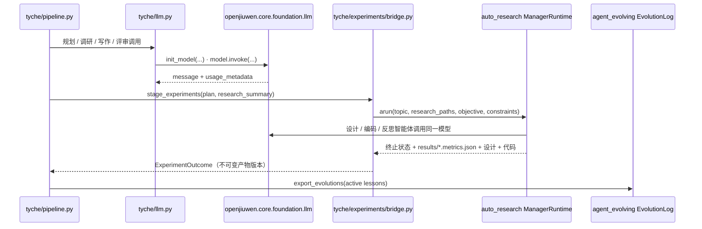

# openJiuwen 模块调用说明

Tyche 基于 openJiuwen agent-core SDK（`openjiuwen`，锁定提交 `9e3390195a9ea15235b2b5f7412cb2aa440622cc`）和 JiuwenSwarm 蜂群框架开发。它只调用这些库的公开模块，不修改其源码；需要调整行为时，在 Tyche 侧用子类或调用参数实现。下面按用途列出全部调用点，路径相对于 `code/`。

## 1. 模型接入：`openjiuwen.core.foundation.llm`

| 调用 | 位置 | 用法 |
|---|---|---|
| `init_model(provider, model_name, api_key, api_base, temperature=, max_tokens=, timeout=, verify_ssl=True, extra_body=, ...)` | `tyche/llm.py` `OpenJiuwenLLM._build_model` | 为规划、写作、评审、实验等角色各创建一个 openJiuwen 模型对象。`extra_body` 用于传递 `reasoning_effort` 等服务特定字段；提示缓存的路由提示按服务类型附加（`tyche/cache.py`） |
| `model.invoke(messages, temperature=, max_tokens=, **hints)` | `tyche/llm.py` `OpenJiuwenLLM._invoke` | Tyche 的每次模型调用。连接中断、超时、429 与 5xx 按 5、20、60、120 秒退避重试 |
| `message.usage_metadata`（`input_tokens`、`output_tokens`、`cache_read_tokens`、`cache_status`） | `tyche/llm.py` | 逐次写入 `usage.jsonl`，用于运行报告和资源报告中的 token 与缓存统计 |

同一个模型对象通过 `OpenJiuwenLLM.openjiuwen_model` 交给实验引擎，因此 openJiuwen 实验智能体与 Tyche 使用相同的模型配置。

Tyche 自己的规划、作者与评审智能体（`tyche/agent/`）同样经由这个模型对象调用模型：智能体的每一轮是一次 `model.invoke`，工具调用写在回复文本中，由 Tyche 在宿主侧解析与执行。实验阶段的设计、编码与执行智能体是 openJiuwen 的 DeepAgent（见第 2 节）。Tyche 的写作与评审智能体没有建在 DeepAgent 上，而是使用自己的轻量运行时，原因有二：一是每个会话保持为一段只追加的对话，服务端提示缓存可以覆盖此前所有轮次；二是工具集合、结束前检查与回滚都要受 Tyche 证据边界的约束。

## 2. 实验闭环：`openjiuwen.rsi.artifact_rsi.paper_opt.auto_research`

Tyche 不重写实验自动化，而是直接驱动 openJiuwen `auto_research` 的 `ManagerRuntime`。JiuwenSwarm 的 RSI 论文 provider 使用的也是这个运行时。Tyche 只开启其中的科学闭环：

```
experiment_design → code_implementation → experiment_execution → reflection
```

调研（`topic_survey`）与报告（`reporting`）模块被关闭：研究输入改用 Tyche 已核验的文献综述，论文由 Tyche 用 ICLR 模板撰写。

| 调用 | 位置 | 用法 |
|---|---|---|
| `configs/pipeline.default.yaml`（经 `importlib.resources` 读取） | `tyche/experiments/bridge.py` `build_openjiuwen_config` | 读取 auto_research 的默认配置，设置 `manager.modules` / `pipeline.modules` 开关、`max_rounds` 等回合与重试上限，以及 `openjiuwen` 模型段 |
| `pipeline.manager.ManagerRuntime(config, manager=, model=, experiment_design=, code_implementation=, reflection=)` | `OpenJiuwenEngine.run` | 组装实验运行时 |
| `ManagerRuntime.arun(resume=, topic=, research_paths=, run_id=, objective=, constraints=, initial_prompt=, task_mode="create_new_paper")` | `OpenJiuwenEngine.run` | 输入 Tyche 的 `research_summary.md` 与研究计划，外加目标（假设、方法、基线、指标、变体上限）和实验约束（逐条目记录、禁止硬编码指标、调用预算、缓存友好的提示结构等，见 `config.yaml` 的 `experiments.constraints`） |
| `modules.manager.agent.ManagerAgent` | 同上 | 实验编排智能体 |
| `modules.experiment_design.agent.ExperimentDesignAgent` | 同上 | 实验设计智能体 |
| `modules.code_implementation.agent.CodeImplementationAgent` | `code_implementation_agent()` | 以子类 `TycheCodeImplementationAgent` 使用，见下文 |
| `modules.reflection.agent.ReflectionAgent` | 同上 | 根据执行结果反思并修订设计 |
| `modules.manager.artifacts.try_load_state(run_id)` | `_resumable_manager_run`、`_latest_execution_variants` | 判断上次尝试是否被中断（没有终止记录时原地续跑），并只收集最近一次执行中成功完成的变体 |
| `common.workspace`（`set_project_root`、`results_dir`、`experiment_design_path`、`generated_code_dir`、`reflection_dir`、`agent_workspace_dir`、`project_root`） | `bridge.py` | 定位实验目录，收集指标文件、设计文档、生成代码与反思记录，并以不可变产物版本存入运行记录 |
| `extensions.rails.openjiuwen_reference_rail` | `tyche/cli.py` `doctor` | 检查编码智能体依赖的 SDK 参考文档是否已安装（`setup_env.sh` 按锁定提交获取） |

**对编码智能体的两处适配**（`TycheCodeImplementationAgent`，只使用公开的构造参数与子类重写）：

1. openJiuwen 的 `harness.subagents.create_code_agent` 默认每次调用只允许 15 轮 ReAct，往往在 `run.py` 写出之前就用完。Tyche 在构建编码智能体时，通过工厂函数公开的 `max_iterations` 参数把上限设为 `experiments.code_agent_max_iterations`（默认 80）。
2. 设计修订后，如果某一轮编码没有改动任何源文件（只读了旧代码就结束），Tyche 会附上明确的宿主指令再运行一次，确保修订后的设计真正被实现。另外，指令中 “Read First” 列出的输入文件会被镜像到编码智能体的沙箱内，避免这些读取被沙箱拒绝。

**生成的实验代码如何调用模型**：`model_environment()` 在实验运行期间设置 `API_KEY`、`API_BASE`、`MODEL_NAME`、`MODEL_PROVIDER`、`MODEL_TIMEOUT` 这些环境变量，也就是 auto_research 各模块读取的同一组名字，结束后恢复原值。密钥不写入任何文件。

**每次尝试相互隔离**：每次实验尝试使用新的 manager run id（`tyche-<run>-a<N>`）；被中断的尝试会原地续跑。设计修订后遗留在 `results/` 中的旧变体不会被收集。

## 3. 技能演进：`openjiuwen.agent_evolving.checkpointing.types`

| 调用 | 位置 | 用法 |
|---|---|---|
| `EvolutionLog.empty / from_dict / to_dict`、`EvolutionRecord.make`、`EvolutionPatch` | `tyche/evolution/playbook.py` `export_evolutions` | 把晋升为 active 的写作经验导出为 JiuwenSwarm 技能的 `evolutions.json`（来源标记为 `tyche-review-ledger`），保留 JiuwenSwarm 或人工添加的其他演进记录，可在 JiuwenSwarm 中查看和回滚 |

## 4. 蜂群编排：JiuwenSwarm SwarmFlow 技能

| 组件 | 位置 | 用法 |
|---|---|---|
| `swarmflow.phase / agent / human / log` | `skills/tyche-iclr-paper/scripts/workflow.py` | 把 Tyche 的 8 个阶段编排成 7 个 SwarmFlow 阶段。每个阶段智能体只执行对应的 `tyche run ... --stop-after <stage>` 命令，再用 `tyche status` 回报状态（结构化 JSON）。`human()` 用于人工审批研究计划：给出修改意见则触发重新规划，不带意见的拒绝会停止流程。该技能通过 JiuwenSwarm `swarmskill-creator` 校验器 |
| Agent 模式技能 | `skills/tyche-paper/SKILL.md` | 在 JiuwenSwarm 对话中以单智能体方式调用同一套命令 |

证据规则（文献核验、数字追溯、编译与页数门禁）全部在 `tyche` 命令内部执行，阶段智能体无法绕过。

## 5. 调用关系总览


